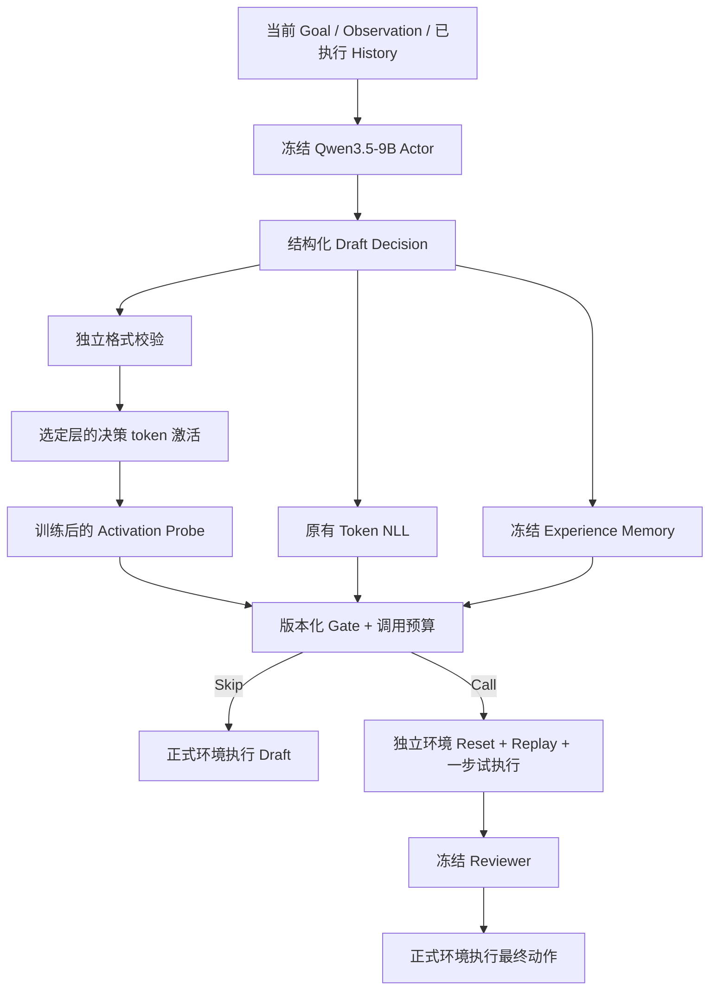

# AgentWMv3：基于模型激活的 WM 选择性调用实现方案

版本：Proposal v1.0
日期：2026-11-16
状态：研究与工程设计，尚未实现、训练或验证。本文不改变服务器上的现有实验。

## 0. 推荐路线与研究定位

建议将当前方法扩展为：

**Frozen Actor/Reviewer + Supervised Activation Probe + Experience Memory + Selective Environment Lookahead。**

Actor 和 Reviewer 继续使用冻结的 `Qwen/Qwen3.5-9B`；WM 继续使用独立真实环境的 Reset + Replay。新增训练对象是轻量 Probe，不微调 Actor/Reviewer，不训练环境转移模型。保留现有 Token NLL、External Memory、Gate 和旧实验作为对照。

不再把 training-free 作为硬约束。新版本应描述为：

> 冻结基础模型，监督训练轻量激活监控器，用于选择性调用真实环境模拟器。

不能继续将整个新系统称为 task-specific training-free。当前 NLL 版本仍可保留这一定位，二者应使用独立配置、checkpoint 和结果目录。

核心目标也需要明确：

**不只检测 Agent 是否可能出错，还要预测当前 WM + Reviewer 是否可能改善决策。**

这是两个不同的学习目标，应分开建标签、分开验证，再考虑共享表示。

## 1. 从文章借鉴什么

OpenAI 的文章使用监督训练的激活 Probe：读取中间层表示，通过 MLP、QV-attention 和 EMA 进行监控，以消息标签监督前缀分数聚合，并在触发后升级到更昂贵的复核；Probe 与被监控 backbone 紧密关联。[1]

本文借鉴其“内部激活监控 → 选择性升级”的结构，具体数据、任务标签、网络规模和 Gate 均为本项目设计，不声称复现其部署实现。

| 可借鉴的方向 | AgentWMv3 中的改造 |
|---|---|
| 内部表示监控 | 读取 Actor 决策文本对应的中间层激活 |
| 轻量监督分类 | 学习动作风险、可修订性和调用收益 |
| 流式聚合 | 后续支持生成过程中累计证据 |
| 触发后升级检查 | 调用真实环境一步 Lookahead，再交给 Reviewer |

文章的安全检测结果不能直接迁移成 Agent 动作正确率或 WM 收益证据。我们需要自己的真实环境标签与独立评估。也不能把其他 backbone 的 Probe 权重直接用于 Qwen3.5-9B。[1]

## 2. 为什么值得尝试，以及它解决不了什么

### 2.1 当前实验提供的动机

当前 ALFWorld 扩展实验实际停止于 236/250 个 Episode；有 47 个任务完成全部五策略。暂时的共同任务结果为：

| 策略 | 成功数 | 成功率 |
|---|---:|---:|
| Never | 7/47 | 14.9% |
| Always | 18/47 | 38.3% |
| Internal NLL | 12/47 | 25.5% |
| External | 7/47 | 14.9% |
| Full | 11/47 | 23.4% |

这些是**不完整评估的描述性结果**，不是最终 50 任务成绩。缺失原因与 Actor 格式失败有关，不能假设缺失完全随机。[2]

当前问题至少有三层：

1. Token NLL 衡量生成文本的意外程度，不直接衡量动作错误或 WM 收益。
2. 外部经验能够指出局部前提冲突，但 Reviewer 未必能产生有用的替代动作。
3. Actor/Reviewer 的结构化输出与行为质量仍有缺陷，不能全部交给 Gate 解决。

因此，Activation Probe 是新的可检验方向，不是已经确定有效的修复。

### 2.2 不应预设的结论

- 激活分数比 NLL 高级，不代表它必然更好。
- 动作错误，不代表 Reviewer 能修正。
- 修订动作可执行，不代表它推进任务。
- 调用后成功，不代表收益来自模拟反馈，可能来自额外一次 Reviewer 推理。
- 若绝大多数状态下 Reviewer 无法提供收益，换 Gate 也无法创造收益。

## 3. 两类 Probe：先分开，再决定是否共享

### 3.1 Action Risk Probe：动作风险

目标：根据当前 Draft 的激活，预测可明确定义的行为问题。

建议先提供几个独立标签，而不是混成一个“错误概率”：

| 输出 | 含义 | 标签可靠性要求 |
|---|---|---|
| `p_native_rejection` | 动作会被原生环境拒绝或明确不执行 | 真实反馈与动作规则支持 |
| `p_state_conflict` | 行动前提与合法可观测状态冲突 | 明确事实证据，无法判断则 Unknown |
| `p_repair_success` | 现有 Reviewer 能产生可执行修订 | 实际运行当前 Reviewer 并执行验证 |

第一版可先实现 `p_native_rejection`，用于跑通激活管线；但它不能成为唯一研究贡献。

**特别注意：当前环境公开 admissible actions。** 如果标签只是“动作是否在该列表内”，直接做成员检查即可，没必要训练 Probe。因此必须加入零训练的 `Admissible-Action Rule` 对照，检查 Probe 是否只是在学习一个已经可直接查询的规则。

### 3.2 WM Utility Probe：调用收益

目标：在当前步骤决定 Call 或 Skip 之前，预测当前完整干预链路的潜在收益：

`环境试执行 + 固定 Reviewer + 最终动作执行`。

建议输出：

```python
{
    "p_help": ...,
    "p_neutral": ...,
    "p_harm": ...,
    "expected_delta_return": ...,
    "uncertainty_or_abstention": ...
}
```

这些分数只针对**固定 Actor、Reviewer、Prompt、环境版本和后续策略**有效。更换 Reviewer 后，旧 Utility 标签和 Probe 都需要重新验证。

推荐顺序：先单独训练 Risk Probe 和 Utility Probe，确认标签与效果，再尝试共享 MLP/注意力聚合器的多头模型。不要一开始就把噪声较大的 Utility 标签和清晰拒绝标签混在一起。

## 4. 总体架构



上线时 Probe 的输入只有当前决策时合法可得的信息。训练时用环境未来结果产生标签，与上线特征路径严格分离。

第一版在**完整 Draft 生成后**做调用决定，不提前中断生成。后续再优化成流式累计激活，避免同时引入“Probe 替换”和“生成中途干预”两个变量。

## 5. 前置工程：先固定结构化输出与故障处理

当前中断案例是 Actor 生成 512 Tokens 的长 Premise，未给出完整 Action；原运行时因此抛出异常并停止全组。这与 Reviewer 的格式失败应分开处理。[2]

训练 Probe 前，需要独立确定一个统一的输出协议版本：

1. Actor 输出结构、字段长度和解析规则固定。
2. 格式错误与环境拒绝使用不同错误码。
3. 单 Episode 异常应隔离，不能让一个样本中止所有任务。
4. 明确无 Action 时是“Agent 格式失败终止”，还是允许固定次数重试；所有策略一致。
5. 基础设施故障与 Agent 输出失败分开统计，不能都算环境任务失败。
6. 不从长篇解释中猜出一个 Action，不凭空补环境反馈。

建议先使用独立 `decision_protocol_v2` 做小规模回归，再冻结它。若改动 Prompt、Schema 或重试策略，需为新版本重新提取激活，并重新校准 NLL 对照。不能把旧版 47 个任务与新版处理后的结果拼成“同配置最终结果”。

格式错误是确定性校验器的职责。不要为了预测“是否缺少 Action”而先训练一个复杂 Probe。

## 6. 激活提取：先保证 token 与位置正确

### 6.1 选取哪些表示

输入为 Actor 实际看到的完整 Prompt，以及它实际生成的完整 Draft。默认只对 **response token** 做 Probe 聚合，排除 Prompt、padding 和终止特殊 token。

记录 Premise、Expected Consequence、Action 三类字段的 token mask；保留全响应聚合与分字段聚合的独立配置。

第一轮只比较少量候选层：约位于解码器深度 1/3、1/2、2/3 的三个层。具体整数层号必须读取实际模型配置后确定，不能沿用 Qwen3-4B/SpanUQ 的层号。

必须检查：

- `Qwen3.5-9B` 实际 decoder 层数与 hidden dimension。
- 所选模块对应 block 输入、block 输出还是最后归一化后的表示。
- Qwen3.5 混合模块中，所选层属于哪类模块。
- `hidden_states` 元组索引与真实 block 编号之间是否存在 embedding 偏移。
- 实际 `named_modules()` 路径，不能猜测固定模块名称。

补充因果性测试：相同 Prompt/response 前缀，拼接不同后缀后，对齐位置的激活应在预先声明的数值容差内一致。差异超过容差时，先排查 mask、位置或内核路径，不继续训练。

训练与上线都记录 `layer_id + module_path + capture_point`，而不是只保存一个整数。

### 6.2 关键位置问题：不要把预测位置误当成当前 token 的表示

自回归模型中，处理前一个位置的 hidden state 用于预测下一个 token。

因此：

- 最后一个 Prompt token 的表示用于预测第一个 response token，不能直接当作第一个 response token 的 post-token 表示。
- 完整处理 response token `y_t` 后的表示才记为 `h_t`。
- 生成结束时，最后一个非 EOS token 的表示是否已经经过下一次 forward，必须检查实际生成过程。

这是接入本方案最容易出现的工程错误之一。

### 6.3 两阶段提取方案

**V1：完成 Draft 后，独立 teacher-forced forward。**

对实际 Prompt + 实际 Draft 做一次冻结模型前向，在选定层捕获 response 位置的 post-token 表示。因模型是因果的，某位置的表示不能使用它后面的 token；但需要实际验证 mask 和实现。

训练数据和首次上线评估都走同一路径，使用相同 dtype、模板、tokenization 和 capture point。该路径容易核对，但增加一次模型 forward，必须计入成本。

**V2：生成时 hook，复用增量计算。**

在已验证 V1 后，捕获生成过程中的选定层输出。通常存在一个 token 的处理滞后；若最后一个 response token 尚未被处理，需要在正确 KV/cache 状态下补一次单 token forward，而不是重新采样动作。

Qwen3.5 的 cache、position 与 mask 应使用已验证的模型接口，不手写猜测逻辑。先验证 V1/V2 的特征和 Probe 分数差异，再决定是否切换。若数值差异不可忽略，重新采集对应训练特征或重新校准，不能混用阈值。

**不要一开始就宣称 Probe 几乎零额外开销。** V1 有额外 forward；V2 的真实开销也需要实测。

### 6.4 计算与存储控制

- 模型保持 `eval()`，所有 Actor 参数 `requires_grad=False`。
- 捕获的激活立即 `detach()`，只训练 Probe。
- 优先 hook 单层，避免保留所有层和完整词表 logits。
- 判断模型是否支持仅计算必要 logits；未经接口验证，不假设存在某个参数。
- 保留现有生成时 NLL，不用 teacher-forced NLL 偷换旧 NLL 对照。

缓存空间估算：`样本数 × 平均响应长度 × hidden_dim × dtype字节数 × 层数`。

例如，假设 hidden_dim=4096、10000 个决策、平均100 tokens、BF16、单层，约为8.2GB。这只是容量示例，不是对 Qwen3.5-9B 实际 hidden_dim 的声明。

## 7. Probe 网络与训练目标

### 7.1 先建立简单对照

使用相同训练划分、标签和特征层，依次比较：

1. response 激活平均池化 + Linear Probe。
2. response 激活平均池化 + 小 MLP。
3. 小 MLP + 注意力池化。
4. 小 MLP + 指数衰减 query–value 池化。

Linear/MLP 是消融基线，不再因为 training-free 而禁止训练。只有复杂聚合器在独立验证上有增益，才保留它。

### 7.2 建议的项目版 Attention/EMA Probe

以下是**本项目的可复现设计**，不是 OpenAI 未公开实现的逐行复现：

```text
单层 h_t
  → 训练集统计量归一化 / 中心化
  → 小 MLP，输出128或256维特征 x_t
  → 4个 query–value pooling heads
  → 可选指数衰减累计
  → 分类/回归输出头
```

一个可实现的池化定义：

```text
s_j,t = q_j^T x_t / sqrt(d)
v_j,t = Wv_j x_t

N_j,t = rho * N_j,t-1 + exp(s_j,t) * v_j,t
D_j,t = rho * D_j,t-1 + exp(s_j,t)
z_j,t = N_j,t / (D_j,t + epsilon)
```

拼接各头 `z_j,t`，得到前缀输出。实际实现必须采用稳定的指数缩放，不能直接让 `exp` 溢出。`rho=1` 是无衰减对照；衰减值只在 Probe Validation 上选择。

归一化统计量只在 Probe Train 上拟合。参数量由实际 hidden_dim 和 MLP 结构计算，先输出准确参数数目，再决定是否需要降低容量。

### 7.3 消息级标签与前缀监督

若只有完整 Draft 的标签，不要将相同标签强行赋给每个 token，尤其不能把高风险 Action 的标签当成其所有正常 Premise token 的真值。

建议先实现完整 Draft 池化后的 BCE / 多分类交叉熵。随后增加一个明确标为项目定义的平滑最大聚合：

```text
A_tau(l_1...l_T) = tau * log(mean(exp(l_t / tau)))
L = BCEWithLogits(A_tau(prefix_logits), message_label)
```

这是一种可测试的 softmax/log-sum-exp 近似设计，**不声称等同于文章的精确训练公式**。需要比较长度敏感性、正常前缀导致的稀释，以及负样本任意前缀的误触发率。

Utility 的三分类/回归头先用完整 Draft 表示训练，不急于加入前缀损失。能否在 Action 尚未生成时预测其收益，本身就是待验证问题。

## 8. 标签体系：绝不能把零奖励当成错误

### 8.1 低成本行为标签

可从合法训练任务的真实轨迹中提取：

- 当前 public admissible actions 与 Draft 的关系。
- 实际动作反馈中的明确拒绝。
- 同一 Episode 中可追溯的状态前提矛盾。
- Reviewer 是否格式正确、是否产生不同动作、动作是否可执行。

必须保留 Unknown：

- `Nothing happens` 可能需要结合动作和状态解释。
- ALFWorld 中大量正确中间动作奖励为0，不能因此标失败。
- 导航、观察和准备动作可能没有即时得分，却是必要步骤。
- 重复动作可能是等待、信息获取或合法重复操作，不自动等于坏动作。
- “与目标无关”如果只来自 LLM Judge，应标 weak label，不能伪装成环境真值。

建议 Schema：

```python
{
    "native_rejection": None,       # True / False / None（Unknown）
    "observable_conflict": None,    # True / False / None（Unknown）
    "revision_executable": None,    # True / False / None（Unknown）
    "label_source": "native_feedback/public_rule/human/llm_weak",
    "label_evidence_ids": [...],
    "label_mask": {...}
}
```

训练损失只作用于有可靠标签的 head；Unknown 不作为负例。

### 8.2 Utility 标签必须使用同状态干预

对合法训练状态 `s_t`：

1. 固定已经生成的 Draft、token IDs、Actor 历史与剩余环境步数。
2. 用两套独立环境 Reset + Replay 相同已执行历史。
3. 验证公共状态、步数、奖励/成功标志和私有验证摘要一致。
4. Branch A：Skip，执行原 Draft。
5. Branch B：Call，一步真实试执行，固定 Reviewer 得到最终动作，再正式执行。
6. 两分支随后使用相同冻结 Actor、采样配置与种子规则，且**统一采用后续 Never WM**。
7. 两分支具有相同剩余正式步数；试执行不计正式步数，但计额外查询与时间。

后续统一 Never 的目的是隔离“当前这一次调用”的影响，避免后续两个 Gate 又做不同干预。

定义：

```text
Delta R(s_t) = R(Call at t, then Never) - R(Skip at t, then Never)
```

ALFWorld 可先用最终 `won` 的0/1返回。ScienceWorld 后续再使用真实最终 Task Score，不能混用不同量纲。

对少量状态用预先固定的多个 continuation seeds 重复，估计差值均值及不稳定性。不得挑选有利 seed。

按预先定义的差值规则划分 Help / Neutral / Harm；临界或重复结果不稳定的状态保留软标签或 Unknown。阈值依据奖励尺度和验证集确定，不能用最终 Test 优化。

**Reviewer 若保持原动作且后续策略相同，期望任务收益通常应接近0，但计算成本仍增加。** 可将这一类作为标签管线一致性检查，不能因此自动宣称所有 KEEP 调用毫无信息价值。

### 8.3 即时修复标签只是代理目标

`原动作被拒绝 → Reviewer修订可执行` 可以训练可修复性，但不等于正向任务收益。Utility 主结论必须使用后续真实回报，或明确声明只预测即时修复。

## 9. 数据划分与泄漏防线

### 9.1 建议的新数据角色

| 数据角色 | 用途 | 禁止用途 |
|---|---|---|
| Probe Train | 拟合 Probe 与归一化统计量 | 最终效果验证 |
| Probe Validation | 选择层、容量、种子与损失 | 当成独立泛化测试 |
| Gate Calibration | 选分数阈值、预算规则或概率校准 | 更新 Actor/用最终 Test 反复调参 |
| Fresh Independent Dev | 完整策略比较 | 继续改方法后仍称 untouched |
| Final Test | 一次性冻结协议评估 | 训练 Probe、合成经验或选择阈值 |

按 canonical goal group 划分，再决定其所有 variations、episodes 和分支归属；不能按步骤随机切分。Call/Skip 两分支必须在同一数据分区。归一化、数据增强、重采样和特征选择均只使用允许的数据。

### 9.2 已看过的数据如何处理

- 当前 3-task pilot 和已分析的50任务清单全部标记为 exposed，包括尚未跑完的任务。
- 现有47共同任务可作为回归与故障分析，不能再称新 Probe 的独立泛化验证集。
- 原有 Memory、NLL Calibration、环境验证和初步探测任务都进入暴露清单。
- 第一版 Probe 另从合法 TRAIN 池分配新 goal groups，排除上述来源及最终140 Test canonical goals。
- 在剩余组中，可先按约60%/15%/10%/15%分为 Train/Validation/Gate Calibration/Fresh Dev；实际数量取决于审计后余量，不承诺固定可用组数。

如果数据不足，优先减少模型容量或缩小研究范围；不能拿最终 Test 填训练集。

### 9.3 标签允许用未来，特征不允许

监督标签可以在训练分区使用真实未来回报。Gate 输入不能包含：

- 当前动作的环境试执行反馈。
- Reviewer 的回答或修订结果。
- 后续 Task Score / success / reward。
- 私有事实、隐藏目标谓词、expert plan、walkthrough。
- 当前 Episode 的未来步骤或之后才构建的经验卡。

保存 `feature_available_at`、`label_observed_at` 和来源 ID。数据加载器分别维护 feature whitelist 与 label whitelist，测试中主动注入未来字段并要求拒绝。

## 10. 训练与资源方案

建议所有数值先作为实验起点，不能写成已经验证的最佳参数。

| 项目 | 起步设置 |
|---|---|
| Actor/Reviewer | 冻结，不参与优化器 |
| Probe | FP32 或经验证的 AMP，小 MLP/Attention |
| 优化器 | AdamW |
| Epoch | 1–3，按验证集早停；必要时最多5 |
| 学习率候选 | 1e-4、3e-4、1e-3，先小范围比较 |
| 随机种子 | 初始至少3个；候选稳定后增加种子 |
| 层候选 | 中段附近三个单层，不先拼接多层 |
| 类别不平衡 | 记录自然分布；加权/重采样只用于训练 |
| 选择标准 | 预先固定验证指标，完整报告种子均值/离散程度 |

不能仅展示最优 seed；选模型与独立评估必须分开。

### 10.1 数据规模分层推进

1. 激活管线：先100–300个真实训练决策，验证形状、边界、数值与成本。
2. 风险标签：约2000–5000个真实训练决策，评估稀有标签与跨任务覆盖。
3. Utility 标签试采：先50–100个真实状态，每状态2分支；仅对部分状态增加重复 seeds。
4. 先测正/负收益比例与标签稳定性，再决定是否值得扩大昂贵标签采集。

例如100状态、每分支平均剩20步，仅后续动作就约4000环境步骤，并可能需要约4000次 Actor 生成，另有 Reviewer、试执行和历史重放。三组 continuation seeds 会使该量级约再乘3。实际成本必须来自日志，不能把“只训练小 Probe”误写成低总成本。

若正向收益极少或重复标签不稳定，先暂停 Utility Probe，检查 Reviewer 和目标定义。不要为凑正样本制造成功案例。

### 10.2 首批资源与停止边界

Probe 训练先用一张可用 GPU；激活/分支采集可在既有最多四卡约束内分批运行，Actor/Reviewer 共用每个进程内的同一冻结模型。具体显存以真实 Qwen3.5-9B 捕获路径实测为准，不预设24GB卡必然足够。

Utility 首批建议每批10个状态、1个 continuation seed，不一次开启全部采集。每批启动前按实际剩余步数计算两分支的最大 Actor/Reviewer 次数、输入输出 Token 上界、Replay 查询及预计时长，再设置硬上限。

预算不足时，不启动该状态的整对分支。运行中断的未完整分支标为未完成标签，不填0、不单独保留更好的那一支。若采用固定短 horizon 代理标签，必须明确命名为短期 Utility，不能冒充完整 Episode 回报。

## 11. Gate 接入：不要把分类分数塞进旧 NLL 阈值

建议新增独立 Provider 输出：

```python
{
    "provider": "activation_probe_v1",
    "score_type": "action_risk_or_wm_utility",
    "risk_scores": {"native_rejection": ..., "state_conflict": ...},
    "utility_scores": {"help": ..., "neutral": ..., "harm": ...},
    "expected_delta_return": ...,
    "validity": "valid/partial/invalid",
    "missing_reason": ...,
    "capture_path": "teacher_forced_post_token_v1",
    "layer_id": ...,
    "capture_point": ...,
    "actor_revision": ...,
    "prompt_sha256": ...,
    "tokenizer_sha256": ...,
    "probe_checkpoint_sha256": ...,
    "latency_and_compute": {...}
}
```

原有 NLL 字段保持原含义。Probe 分数不是 NLL，不能拿0.54485之类旧阈值直接判断它。checkpoint、capture path、dtype 或 Prompt 不匹配时拒绝使用对应阈值。

### 11.1 Risk Gate：最小替换实验

```text
Call = BudgetAvailable AND (HighRisk OR ReliableExternalConflict)
```

该规则只检验激活风险信号是否替代 NLL 更好，仍不是 WM Utility 最优策略。

### 11.2 Utility Gate：主要研究版本

```text
Call = BudgetAvailable
       AND NOT ConfirmedUnchangedAction
       AND p_help > tau_help
       AND p_harm < tau_harm
```

阈值与预算分别配置。若直接优化收益减成本，必须先声明回报与 token/时间/环境查询成本的量纲和权重；否则优先使用固定预算下的性能比较，避免任意混加单位。

### 11.3 External 的接法

先保留独立的 `Activation-Only` 与 `Activation + External` 两组：

- 有可靠 Conflict 时，可采用预先校准的独立 `tau_help_conflict`。
- **Conflict 不应无条件绕过 Harm veto。** 经验指出错误，不代表 Reviewer 能解决。
- Coverage/Conflict/Sufficiency 保留三值语义；Unknown 不作确定证据。
- Sufficiency 只有在经验明确支持当前原动作时才可能允许 Skip。
- “知道一个修正方向”不能在 Memory Correction 关闭时被当成“原动作安全”。

第一版暂不训练额外融合 Router。先验证 Probe 自身，再决定是否值得学习外部特征融合，减少无法归因的同时改动。

Probe 无效、分数缺失或域外输入时，使用已注册的 NLL fallback；预算耗尽则记录未验证执行。所有失败与 fallback 单独统计。

## 12. 如何公平判断有没有用

### 12.1 离线指标

- Risk：AUPRC、AUROC、固定调用率下 Recall、误触发率，按任务组 bootstrap 描述不确定性。
- Utility：Help/Harm 识别、固定调用预算下的 utility capture、被遗漏正收益比例。
- 输出概率若需解释为概率，应独立校准，报告 Brier/ECE；原始 sigmoid 不自动视为已校准概率。
- 分析低 NLL 错误、高 NLL 正确、自然外部冲突和 Unknown 样本。
- 检查正常长前缀、字段重排或无关文字是否改变 Probe 分数；这属于鲁棒性测试，不作为真实 Benchmark 成果。

离线分类更准不等于在线任务收益更高。

### 12.2 完整 Episode 对照

至少保留：

1. Never。
2. Always。
3. 当前 NLL Internal。
4. 当前 NLL Full。
5. Admissible-Action Rule。
6. Random Matched-Budget。
7. Activation Risk Gate。
8. Activation Utility Gate。
9. Activation Utility + External。

再按资源增加 Mean/MLP/Attention/EMA、局部/整体激活消融；不要第一轮同时扫所有模型结构。

所有策略统一 Actor、Reviewer、格式失败协议、WM、任务/种子、Prompt、simulation depth、Memory 和 Memory Correction 设置。未使用 Probe 的策略不承担其额外 forward 成本。

必须增加一个诊断：**额外 Reviewer 推理，但不提供模拟反馈**。它用于区分“多思考一次”的收益和“真实试执行信息”的收益，作为独立版本，不能替换原 Always。

在新独立 Dev 上冻结比较后，才考虑正式 Test。单 seed 的50任务不能提供跨 seed sample SD；多 seed 阶段分别完成固定任务集，再按 seed-level 均值报告 mean±sample SD。

### 12.3 成本与结果一起报告

计入 Actor/Reviewer tokens、激活提取 forward、Probe forward、检索/Judge、正式环境步骤、Lookahead/Replay/inspection 查询和全链路延迟。

Probe 训练、特征缓存构建、Utility 分支标签采集属于离线成本，单独报告。提供摊销曲线：部署多少 Episode 后，节约的在线成本才能覆盖离线开销；若没有覆盖，不称整体降本。

## 13. 拟新增与修改的文件

以下是**拟议文件**，并非已存在或已实现的接口。

| 文件 | 目的 |
|---|---|
| `internal_signals/activation_capture.py` | 层定位、post-token 激活与字段 mask |
| `internal_signals/activation_probe.py` | Linear/MLP/Attention/EMA Probe |
| `internal_signals/activation_provider.py` | 统一输出与 checkpoint/版本检查 |
| `gates/probe_gate.py` | Risk/Utility/External 版本化规则 |
| `scripts/collect_activation_cases.py` | 仅合法训练划分的真实特征采集 |
| `scripts/collect_probe_utility_labels.py` | 同状态 Call/Skip 分支标签 |
| `scripts/train_activation_probe.py` | 只训练 Probe |
| `scripts/eval_activation_probe.py` | 离线验证与预算曲线 |
| `scripts/run_alfworld_activation_gate.py` | 复用当前 Episode/runtime 的接入入口 |
| `analysis/probe_diagnostics.py` | 互补性、错误类型、漂移与成本分析 |
| `configs/internal_signals/activation_probe_*.json` | 层、路径、容量与 checkpoint 配置 |
| `tests/test_activation_*.py` | 对齐、隔离、数值和版本契约 |

优先扩展现有 `qwen35_actor.py`、`hf_actor.py` 和 Provider 接口，不重写已验证的环境 Reset/Replay 或 Agent Loop。现有 `gates/core.py` 与旧配置保留用于复现。

模型权重、大激活缓存、完整大日志不提交 Git。checkpoint 保存训练划分 hash、模型/tokenizer/Prompt/Reviewer/环境版本、层语义、归一化参数、训练种子和验证选择记录。

上述脚本尚未实现，因此本文不提供冒充可直接运行的训练命令。

## 14. 分阶段实现与验收

采用 AP 编号，避免与现有项目 Phase 6 混淆。每阶段完成后独立验收，不自动进入完整正式评测。

| 阶段 | 工作 | 验收 |
|---|---|---|
| AP0 | 冻结输出/故障协议与新数据分区，审查 Reviewer 收益潜力 | 无全组格式错误连锁中止；分区审计通过；旧结果保留 |
| AP1 | 单层 teacher-forced 激活、字段 mask、capture metadata | 实测层/shape正确；prompt/response和next-token偏移测试通过 |
| AP2 | 小规模 Risk 标签与简单 Probe | 优于或解释与直接 admissible rule 的差距；独立验证无泄漏 |
| AP3 | 50–100状态 Utility 标签试采与重复性检查 | 同状态重建通过；正/负/零收益及 Unknown 分布真实可审计 |
| AP4 | Utility Probe、简单融合与预算校准 | 验证集模型选择固定；风险/收益分数含义分离；不使用新独立 Dev 调参 |
| AP5 | 新独立任务完整 Episode 对照 | 统一协议、实际 Call/Skip、完整成本与配对结果；无效果也如实保留 |
| AP6 | 流式 hook/EMA 优化及扩域 | 训练/部署特征一致性与成本实测通过；跨 benchmark 单独审计 |

停止条件：

- 无可靠同状态重建，则不生产“真实 WM Utility”标签。
- 正收益太稀少或标签不稳定，先审查 Reviewer，而非强行训练出正结果。
- Probe 只学会廉价 admissible 查询，不声称发现新的内部风险信息。
- 激活训练/上线路径无法对齐，不把旧 checkpoint 直接上线。
- 分类指标改善但任务/成本无改善，不宣称选择性调用有效。

## 15. 推荐的最小可行版本

第一轮聚焦 ALFWorld，不同时改 ScienceWorld、WebShop 和 Actor backbone。

1. 固定新的统一输出/故障协议，冻结 Qwen3.5-9B 和 Reviewer。
2. 用少量真实训练决策跑通单层 post-token 激活。
3. 比较 NLL、admissible rule、Mean+Linear 与 Mean+MLP，先判断激活是否提供额外信息。
4. 在训练任务采集少量同状态 Utility 标签，测量 Reviewer 的真实收益上限与标签稀疏度。
5. 只有标签可用，再训练 Attention/EMA Utility Probe。
6. 在新的独立 Dev 上比较 Utility-Only 与 Utility+External，连同真实成本报告。

真正值得写进研究结论的，不是“使用了激活分类器”，而是：

> 在冻结 Actor/Reviewer 的条件下，激活表示能否比 Token NLL 更好地识别值得升级检查的决策，并在相同调用预算或完整成本下改善真实任务结果？外部经验是否提供了可重复的额外贡献？

这些都需要实验回答，本文不预设结果。

## 16. 参考与证据边界

1. [OpenAI：Training activation classifiers for safety and alignment](https://alignment.openai.com/training-activation-classifiers/)，2026-11-02。本文借鉴监控架构与升级思想；项目版网络、损失和标签不是其官方实现。
2. [AgentWMv3：ALFWorld 236/250 停止后的47共同任务报告](https://github.com/ShiningIVYYY/agentwmv3/blob/50709be/docs/ALFWORLD_DEV50_PARTIAL_REPORT.md)。以上项目数字来自该版本，未当成最终50任务成绩。
3. [当前 Token NLL 实现](https://github.com/ShiningIVYYY/agentwmv3/blob/9aa4be6/internal_signals/hf_actor.py) 与 [Provider](https://github.com/ShiningIVYYY/agentwmv3/blob/9aa4be6/internal_signals/provider.py)。旧计算路径应保留用于对照。
4. [固定50任务协议](https://github.com/ShiningIVYYY/agentwmv3/blob/9aa4be6/docs/ALFWORLD_DEV50.md)。正式评测需继续遵守项目已有 Paper-Aligned 协议，同时明确模型、Prompt 与真实模拟器的信息权限差异。

交付范围：仅本地方案文档；没有修改服务器代码、补跑实验或训练任何模型。
