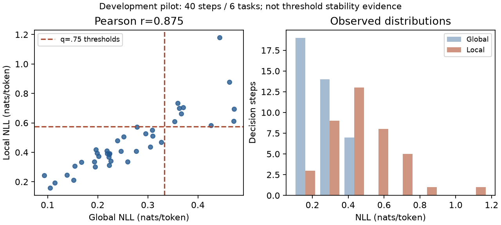

# Phase 5.7：Qwen3.5-9B + 严格验证的 Reset + Replay

**新的受限架构已完成集成和小规模真实验证。Reset + Replay 并非对所有状态可靠；验证失败时明确回退，不使用未验证反馈。没有进入 Phase 6。**

本报告按用户后续批准的 Reset + Replay 要求执行，不再把完整 Java/JVM 序列化作为前提。最初的克隆审查保存在 `PHASE5_7_INITIAL_AUDIT.md`，其中的停止条件是历史要求。

## A. 当前完成的工作

- Actor 与 Reviewer 均为官方 post-trained `Qwen/Qwen3.5-9B`，共用一个冻结 HF 模型实例，非思考模式；新路径没有 Qwen2.5-7B 请求或服务。
- 实现独立 JVM 重置、完整已执行历史重放、逐步状态验证及一次 Draft Action 真实试执行。正式环境只执行 Final Action，不试执行、不回滚、不采用副本状态。
- 保留原决策格式、Token NLL 算法、冻结 Memory、三值 External Signals 和 Gate 判断规则。增加单步/单轮协议的预算契约；旧四预测预算协议保留。
- 在合法开发任务完成 40 个真实决策的分布校准，随后冻结阈值，在另外三个开发任务上完成四策略共 12 个 Episode、201 个正式动作。
- 完成真实 CPU 重放验证、91 项测试、独立轨迹/成本/时序审计，以及纯推理环境的数值兼容性和 SDK 检查。

## B. 修改或新增的文件

| 文件 | 目的 |
| --- | --- |
| `worldmodel/ground_truth_environment.py` | 独立 JVM、逐前缀重建检查、一步真实反馈、明确失败与资源清理 |
| `internal_signals/qwen35_actor.py` | 严格加载官方完整 9B 权重；Actor/Reviewer 共享模型；官方 EOS 校验 |
| `internal_signals/{hf_actor,provider}.py` | 最小兼容扩展，增加独立 9B backend 标识；旧 4B 行为保留 |
| `reflection/replay_review.py` | 固定通用 Reviewer Prompt、一次生成、KEEP/REPLACE 解析与错误回退 |
| `gates/core.py` | 为明确的新协议接受一次预测预算；不改变不确定性/经验组合规则 |
| `configs/internal_signals/qwen35_9b_replay_v1.json` | 模型、dtype、模板、EOS、采样和新计算路径配置 |
| `configs/evaluation/phase57_replay_dev_v1.json` | 独立开发诊断配置，保留旧 paper-aligned 配置 |
| `configs/gates/qwen35_replay_pilot_v1.json` | 从实际开发信号得到的冻结试用阈值；预算单独配置 |
| `scripts/run_phase57_replay.py` | 受限开发入口、严格校准复用、生成即时日志和完整 Episode |
| `scripts/{validate_reset_replay,reproduce_replay_rng}.py` | 多任务/种子/历史长度真实重放及失败最小复现 |
| `scripts/{test_replay_integration,test_qwen35_tokenizer}.py` | 协议、预算、隐私、字段、EOS、真实 tokenizer 测试 |
| `scripts/{audit_phase57_replay,export_phase57_evidence,plot_phase57_signals}.py` | 独立复算、紧凑真实证据和 NLL 图 |
| `scripts/{download_qwen35,verify_qwen35_environment}.py` | 固定官方资源、只读核验与独立环境数值/SDK 验证 |
| `environment/qwen35-replay-{requirements,lock}.txt` | 实际依赖与纯推理环境锁定 |
| `docs/phase57_replay/` 及相关文档、README、计划、进度 | 真实结果、失败记录、版本、命令及恢复说明 |

没有修改 `agentwmv2`、原有 Memory 规则/快照、旧阈值、最终 200 个任务或 `PAPER_ALIGNED_EVAL.md`。现有 Agent/benchmark 历史入口保留；新增的是有任务数量限制的开发驱动，复用既有 Prompt、解析、NLL、Memory、Gate 和动作视图，不冒充完整正式评测入口。

## C. 关键实现与验收逐项答复

**模型与信号。** 权重 Revision：`c202236235762e1c871ad0ccb60c8ee5ba337b9a`。四个 safetensor 的 SHA256 均与官方 LFS 一致，严格加载的 missing/unexpected/mismatched/error 集合为空。参数 BF16、冻结、SDPA；未安装可选快速 DeltaNet kernel，使用官方 PyTorch reference 实现。Actor/Reviewer 同一模型对象、不同固定 Prompt，采样均 T=0.4/top_p=1/top_k=0，response512/prompt4096/history2。

正式 NLL 路径是 `hf_qwen35_generation_raw_bf16_v1`：BF16 模型生成原始 logits，在同 GPU 做 FP32 cross entropy reduction，取样温度不进入评分。Premise/Consequence 内容各自均值，Local 取最大；Global 包括字段标签和 Action，排除 prompt、EOS、padding/special tokens。缺失保持 null。配置指纹 `cad3791bc197e7f95baa16837d072ab26b68b6f76cb12cf164e0ccfcaf71a7a6`。

**环境重建。** B 与 A 使用相同 Task/Variation/Simplification/Seed，重放每个已提交动作，包括无效动作和数字歧义选择。每个前缀比较 observation/reward/score/done/moves、room/inventory、SDK last score、执行历史、object-tree hash、部分 RNG 和映射。隐藏树/RNG 仅用于审计，不能进入模型 Prompt。不是完整隐藏状态相等的证明。

SDK1.2.3 的合法动作枚举会消耗全局 RNG，且 `load` 会覆盖加载前的 seed。因此新 Python 封装使用公开 native step/score 接口，保留同样 reward/评分/终止条件，省去不需要的随机枚举，在 load 后设置转移 seed。没有修改已安装 SDK、Java 或 Scala。这个查询/seed profile 对四种新策略统一，不能声称与旧查询日程完全等同。

重建不通过：`prediction_available=false`，不返回预测字段、不调用 Reviewer，消耗本次尝试预算并执行原 Draft。这里的“安全”指状态和信息安全，不保证原动作正确。成功时只模拟一次 Draft、最多一次 Reviewer；修订动作不再额外模拟。KEEP 在 A 正常执行后必须与 B 的公共转移一致，否则停止。Reviewer 只能看到 Goal、当前公开状态、两步真实历史及允许的 trial observation/reward/done/score。

| 验收问题 | 回答 |
| --- | --- |
| 1. Actor 是否已替换？ | 是。真实 9B 结构化决策已执行，201 个评测动作的 Draft 格式无解析失败。 |
| 2. Reviewer 是否同一模型？ | 是。21 次真实 Reviewer 调用，模型 Revision/配置与 Actor 一致，源代码复用同一对象。 |
| 3. 是否停止 Qwen2.5-7B？ | 是。新路径零调用、未启动相关服务，历史代码保留。 |
| 4. ScienceWorld 是否支持可靠复制？ | 独立实例可创建；Reset + Replay 只在严格验证通过的子集可用，不能泛称任意状态可靠复制。 |
| 5. Ground-Truth WM 是否运行？ | 是。75 次尝试中 21 次通过并产生真实一步反馈，54 次拒绝。 |
| 6. 是否污染正式轨迹？ | 本次所有调用的正式状态前后检查通过；8 个保留 Draft 的端到端转移完全匹配。没有正式试执行/回滚。 |
| 7. NLL 是否重新验证/校准？ | 是；同 GPU raw-logit 核对精确一致，真实 tokenizer/重复性/路径测试通过。40 步试用分位数已冻结，但不足以证明稳定校准。 |
| 8. Reviewer 能否修正？ | 能修复部分前提失败；但 13 次实际改动作中 7 次仍有明确执行拒绝，不能称为稳定可靠。 |
| 9. 四策略真实结果？ | 见下表，所有成功率为 0；一个 seed，没有跨 seed sample SD。 |
| 10. 正向收益调用？ | 有一例修订使即时分数比副本 Draft 多 8 分；没有证明严格后续 Call/Skip 反事实收益。 |
| 11. 完整成本？ | 完成运行的所有 Actor/Reviewer tokens、重建/重放/候选查询和时延均计入；历史失败有两次生成收据缺失，不能虚构整个阶段精确总 Token。 |
| 12. 是否进入 Phase 6？ | 不自动进入，也不建议立即全量。先处理可用性、Reviewer 可靠性和独立开发复验。 |

## D. 实际测试、结果与成本

**重放验证。** 开发 IDs128/142/2417/3070、三个 seed0/1/7、历史长度0/2/4/8，共48场景。原 SDK 查询日程仅6通过/42拒绝；修正查询日程后两次均27通过/21拒绝、0个“验证通过但随后公共转移不同”，正式隔离检查全部通过。物体温度在 `wait` 后真实漂移，例如24.20014089209703 与24.200482233189756；仍按严格树不一致拒绝，未通过容差或特例放行。

**开发校准。** IDs142/1481/383/4420/3342/4215，40个有效步骤、6个任务，缺失0。Pearson0.875301、Spearman0.918199。预设q=.75：Local **0.5749072272810143**、Global **0.3332634086050418**；样本内无预算调用率25%。q=.5/.9 对应57.5%/15%，没有按任务成绩挑阈值。预算独立预设0/20/5/5。修复索引错误后严格复用相同数据/模型/计算哈希，未重新采样或调参。



**完整 Episode。** 相同 IDs128/2417/3070、相同 seed0，H20/SDK native tick cap21、相同新 Actor/Reviewer/profile/Memory。任务实例等权，不按 batch/category 等权。

| 策略 | 三个最终 Task Score | 均值 | 成功率 | 正式动作 | Call尝试 / 验证成功 | Reviewer | 总LLM Tokens | Episode秒 |
| --- | --- | ---: | ---: | ---: | ---: | ---: | ---: | ---: |
| Never | -100,-100,17 | -61.00 | 0% | 44 | 0 / 0 | 0 | 20,775 | 92.62 |
| Always | -100,60,17 | -7.67 | 0% | 54 | 54 / 9 | 9 | 32,875 | 248.45 |
| Internal | -100,-100,-100 | -100.00 | 0% | 43 | 7 / 4 | 4 | 24,418 | 117.76 |
| Full | 40,60,25 | 41.67 | 0% | 60 | 14 / 8 | 8 | 33,268 | 194.97 |

Episode秒包含生成/信号/模拟等在线过程，但排除正式 JVM 构建和销毁。v5从启动到最终汇总 **696.61秒** 包含这些共享/初始化开销、模型加载与一次数值验证。没有连续计量完整 driver VRAM peak；逐生成 Torch peak allocated 最大约 **17.87GiB**，使用一张RTX4090。

| 额外模拟成本 | Always | Internal | Full |
| --- | ---: | ---: | ---: |
| 新 worker JVM / 初始化查询 | 54 | 7 | 14 |
| 历史重放动作查询 | 127 | 36 | 39 |
| 候选一步查询 | 9 | 4 | 8 |
| 三者合计 | 190 | 47 | 61 |
| 模拟总秒（含验证/清理） | 95.01 | 14.95 | 26.26 |

共201 Actor+21 Reviewer=222个评测模型调用、111,336 Tokens；v5另一次普通输入验证后为223调用/111,356 Tokens。开发校准40调用/16,808 Tokens另计。在线额外 NLL forward为0，103次提取共约0.350秒。Full检索60次约0.01579秒，规则Judge约0.00149秒，LLM Judge0；新离线经验构建0。正式 Episode 初始化另12次查询，不能混入201个正式动作；额外重放/初始化/候选共298次查询，另有744个状态审计 capture bundle，其耗时计入模拟总秒。

Full 比 Always 的尝试/模拟查询更少、Episode时延更低，**总LLM Tokens却略高**，不能宣称所有成本均下降。Total Inference Cost 必须作为 tokens/时延/额外环境查询分别报告；没有可靠货币/FLOP换算。历史v1普通输入、v4第一个评测Draft的生成收据未落盘，阶段精确总 Token 未知；后续增加即时日志，保留失败记录，不以重跑值填补。

**真实案例。** 完整输入/输出、证据 IDs、时间及成本见 [trace_examples.json](phase57_replay/trace_examples.json)。

1. Full3070第8步：Local0.298834、Global0.178883 均低于阈值；闭门经验触发 Call。`go kitchen` 在B返回门未打开；Reviewer改为 `open door to the kitchen`，A返回门已打开，即时分数差 **+8**。这是一例符合H1方向的真实观察，不是总体统计结论。
2. Always2417第2步：`go hallway` → 真实门未打开 → `open door to the hallway` → 执行成功，即时分数差0；动作前提被修复，但不能将0分差当作长期零收益。
3. Always128第2步：WM正确指出 `go kitchen` 门未打开，Reviewer却改成 `go living room`，实际 `No known action matches that input.`，属于有正确反馈仍修订失败。
4. Internal128第13步：Local0.404458、Global0.279943、预算仍有，Gate未触发；`focus on the thermometer` 被执行，但真实任务失败为-100。低NLL不等于动作安全。
5. 重建失败实例：object-tree mismatch 后没有 Reviewer，原Draft正常执行；没有把未验证B反馈伪装为预测。
6. Reviewer把水视为“生物”的理由未获反馈支持。真实反馈可以正确，但目标理解仍然错误。

21次Reviewer输出格式均可解析；14次声明REPLACE，其中1次与Draft相同，实际改动作13次：6次有接受反馈、7次明确拒绝。实际改动作率为13/21 Reviewer调用（61.9%），或13/201正式步骤（6.5%）。改动作调用的即时分数差为1正/12零/0负；加上8次保留Draft则为1正/20零/0负，**均不代表长期效用分布**。存在把合法观察动作替换为失败动作的例子。

没有把 Unknown 强行变成原生动作有效性布尔值。以下是保守公开反馈分类的执行接受率，分母仅包含可分类反馈；显式拒绝同时包含语法/对象不匹配与前提不满足，接受也不等于任务正确（例如错误Focus仍可能被执行）。完整原生Valid Action Rate未取得可靠的无副作用标志：

| 策略 | 接受反馈 | 明确拒绝 | Unknown | 已分类反馈接受率 |
| --- | ---: | ---: | ---: | ---: |
| Never | 25 | 13 | 6 | 65.8% |
| Always | 27 | 17 | 10 | 61.4% |
| Internal | 28 | 9 | 6 | 75.7% |
| Full | 26 | 22 | 12 | 54.2% |

Full的Coverage true10/unknown50、Conflict true5/unknown55、Sufficiency false5/unknown55；没有自然Sufficiency true。相同记录状态和预算下，3次Full调用是内部规则本会跳过、由外部冲突新增的调用。不同策略的后续轨迹并不相同，不能将总体14与7的差异全部归因于这3个状态。没有检验H2的充分性跳过机制。

**命令与通过范围。** 91项测试在纯环境全部通过：8个新合约、6个真实tokenizer、14个原Internal、63个原Gate。真实E2E审计覆盖全部201步、Prompt重建、预算/时序、输入版本、75次Call的隔离与失败回退、8个KEEP匹配、完整222次模型账目。缺失信号分支有单元测试，真实样本缺失为0，不伪造自然缺失例。

```bash
PYTHONNOUSERSITE=1 .venv-qwen35-clean/bin/python scripts/test_replay_integration.py
PYTHONNOUSERSITE=1 .venv-qwen35-clean/bin/python scripts/test_qwen35_tokenizer.py --model-dir checkpoints/qwen35_9b
PYTHONNOUSERSITE=1 .venv-qwen35-clean/bin/python scripts/test_internal_signals.py
PYTHONNOUSERSITE=1 .venv-qwen35-clean/bin/python scripts/test_gates.py

# 实际完成的v5命令，原始结果来自该overlay环境；不能重用已存在的输出目录：
CUDA_VISIBLE_DEVICES=3 PYTHONNOUSERSITE=1 PYTHONPATH=. .venv-qwen35/bin/python \
 scripts/run_phase57_replay.py --model-dir checkpoints/qwen35_9b \
 --output outputs/phase57_replay_9b_v5 --calibration-source outputs/phase57_replay_9b_v4

PYTHONNOUSERSITE=1 .venv-qwen35-clean/bin/python scripts/audit_phase57_replay.py \
 --run outputs/phase57_replay_9b_v5 --output outputs/new_audit_run
```

初始overlay继承了无关RL包约束，**没有**隐瞒其pip冲突。已另建 `.venv-qwen35-clean`：所有依赖位于新venv、pip check0、91项测试通过；两个固定真实Prompt的Actor/Reviewer token与原运行一致，Actor NLL差0，另一次原生SDK独立重放匹配。该兼容性验证2个模型调用/1,224 Tokens、4个环境查询，不是新Benchmark结果，也不冒充12个Episode已在新环境重跑。旧环境版本未变。

## E. 遗留问题与科学局限

- 动态物理状态有跨JVM漂移。实际75次尝试仅21成功，不能把Reset+Replay描述成通用精确克隆。失败选择性还会影响不同策略实际可获得的信息。
- 7/13修订被明确拒绝；准确真实反馈不等于Reviewer能生成正确动作。未按已见任务答案追加特例。
- 全部成功率0。Full三个Episode均到20步上限；错误修订可能改变/延迟失败，部分分数还受截断影响。不能把均分差异当作稳定能力或严格因果效用。
- 只有3个开发任务/1seed，且这些开发实例此前已暴露；没有跨seed sample SD、显著性或泛化结论。40步/6任务阈值是试用分布校准，非充分验证。
- 本方法有额外真实模拟器和校验状态访问权限，不等同普通learned WM。没有完整隐藏状态证明、没有同状态整条Call/Skip续跑对照。
- 保留原正式评测协议，但新9B模型与native查询/seed封装是独立研究设置；不能与论文RL模型或旧4B/7B结果直接归因比较。ALFWorld/WebShop未推进。

## F. 下一步建议

建议先在独立开发样本/多个seed复验Replay可用性、Reviewer通用动作约束和收益/失败分布，明确是否接受大量拒绝回退；不要直接200×8。若增加通用有效性检查或改Reviewer，应保留当前版本为独立变体，所有可比Gate共享修订机制。继续冻结经验、阈值选择口径与测试集，不未经批准改Java/Scala或恢复旧WM。

## G. 停止与交付

本阶段结束，等待用户确认后续步骤。没有进入Phase6。紧凑真实证据在 `docs/phase57_replay/`；大轨迹、权重、缓存仍在被忽略的目录。最终Commit/推送状态在交付消息报告，避免在提交内写自引用SHA。
