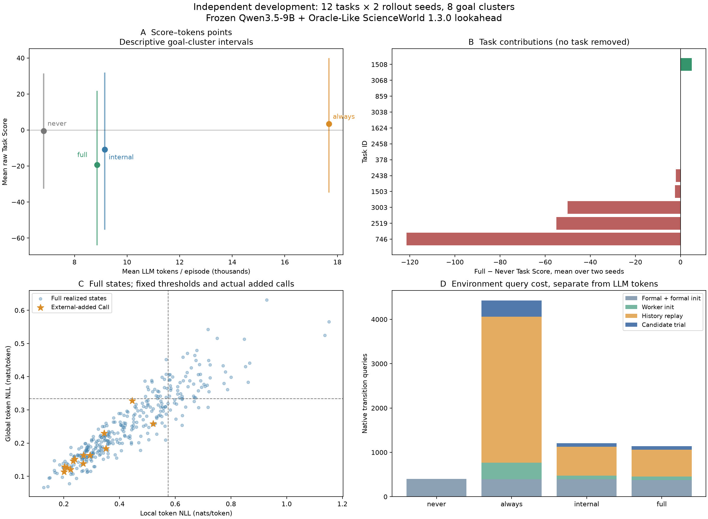

# Phase 5.9 — Independent Development Evaluation

状态：**本阶段完成；不进入 Phase 6，等待用户确认。** 完成预先冻结的 12 Task IDs × 2 Rollout Seeds × 4 策略，共 96 个真实 Episode。第一轮 20 个 Episode 全部保留并计入这 96 个；没有按结果重跑、补选任务或修改研究方法。

结论：工程可运行，但这次独立开发评估**没有复现 Full 的任务收益**。Full 平均 Task Score −19.375、成功率 0%，低于 Never、Always 和 Internal 的点估计。Full 相比 Always 减少成本，但相比 Never 同时增加成本并降低分数。建议先在独立命名的新版本中诊断 Reviewer/Verification，再决定 Phase 6；本阶段没有实施这类算法调整。

## A. 完成工作与冻结版本

- 方法基础：`6e564390955f136ea80d57facffd2e50c8543d34`；实验前注册：`1ac8a8473b92c68ba782d99e92978ab75f8fe5a0`；审计读取修复：`830d2abceac788c5e8e69813c9fde5941fac7994`。最终文档/分析提交见 Git 历史与交付说明，不混同于生成数据的代码版本。
- Actor/Reviewer：冻结的官方 post-trained `Qwen/Qwen3.5-9B`，同一 Worker 共用同一个模型对象；Revision `c202236235762e1c871ad0ccb60c8ee5ba337b9a`。13 个本地模型/tokenizer 资产 SHA 校验通过，严格加载无 missing/unexpected/mismatched keys；本次不下载新权重、不训练、不启动 Qwen2.5。
- HF `5.22.2` / Torch `2.8.0+cu128` / Python `3.12.0` / BF16，后端 `hf_qwen35_generation_raw_bf16_v1`。配置指纹 `cad3791bc197e7f95baa16837d072ab26b68b6f76cb12cf164e0ccfcaf71a7a6`。
- Native ScienceWorld `1.3.0`，官方 Commit `e8216d6044e8e39be9fcb185e3b2dfb602584b52`，Jar SHA256 `e77b0fee7d68abe3ca5b12e57d86e2bfe7603f20c5200da0b0f085939faeb465`；SDK Python 客户端仍为 `1.2.3`，通过 serverPath 指定该 Jar，不覆盖旧环境。Java `1.8.0_452`。
- 保留既有独立 JVM Reset/Replay：全部正式动作历史重放、核验前缀、只试执行 Draft 一步、最多一次 Reviewer；失败则无可用预测、保留 Draft，不在正式环境试执行或回滚。Reviewer 只接收白名单公共反馈，状态树/RNG/任务内部数据仅用于隔离核验。
- Memory 冻结为 `docs/phase5/memory_snapshot_v2.json`：3 张卡片/54 个合法训练案例；覆盖门操作及有限导航前提，未扩充、未改 Conflict 条件。CPU 规则 Judge，无 LLM Judge。
- Gate、Reviewer Prompt/Parser、Missing/Unknown 规则和动作修订逻辑不变。Memory Correction 与 Confirmed-Action Skip 都关闭；经验冲突不能借 Sufficiency 跳过仍未修正的错误动作。
- 阈值 Local `0.5749072272810143`、Global `0.3332634086050418`，仍是此前 40 步分布校准结果；本阶段没有重新校准或用得分选规则。Episode WM Budget：Never 0、Always 20、Internal 5、Full 5。
- H20 / History2 / Prompt4096 / Response512 / T0.4 / Top-p1 / Top-k0，官方 nonthinking 模板；Native cap21、Simplification 空串。正式 Actor Turn、Native Moves、模拟查询分别统计。
- Rollout Seeds 0/1；原生 Task/Simulator Seed 固定 0，保持各策略相同初始任务状态。按 Task/Turn/Role 确定请求采样种子，策略和调度不进入 Seed Hash。模型采样种子不等同于环境 Variation/随机状态。
- 完整参数、文件哈希及清单：[冻结配置](../configs/evaluation/phase59_independent_dev_v1.json)、[运行 Manifest](phase59/results/run_manifest.json)、[环境](phase59/results/environment.json)、[资产核验](phase59/results/model_assets_verified.json)。

Local = max(mean Premise 内容 Token NLL, mean Expected Consequence 内容 Token NLL)。Global = 整段 Draft 文本平均 Token NLL，含标签与 Action，排除 Prompt/EOS/Padding/Special Tokens。使用生成时未经 Temperature 变换的原始 logits，GPU FP32 CE；不跨 BF16/FP32 路径混用阈值，也没有额外 backbone forward。这些是未校准生成 NLL，不是错误概率、SpanUQ 输出或 WM Utility。

`PAPER_ALIGNED_EVAL.md` 保持逐字节不变。本次仅使用其已确定的标量限额；9B Actor、结构化 Draft、Native1.3.0 和 Oracle-Like Lookahead 是已声明的架构/环境差异，不能称为论文完全复现或 learned WM 的预测表现。

## B. 数据独立性与任务清单

先对保留的历史 JSON/JSONL、Native Task/Variation 别名、代码声明任务和先前代表任务建立哈希清单，再进行纯 SHA 排序、Task Family 轮转、每个未使用 Goal 最多两个 Variation 的固定选择。197 个合法 Development 实例中，39 IDs/35 Goal Groups 有历史真实使用证据；按真实交互、Native 别名和既有声明排除后剩 32 实例/8 未使用 Goal Groups。本阶段固定 12 实例/5 Native Families/3 大类，首轮前 5 个任务覆盖这 5 Families。选择过程不读取当前任何策略得分。

[Exposure Audit](phase59/exposure_audit.json) 保留来源与哈希。最终 200 Test IDs、训练/Memory IDs、旧 Debug/Calibration/Reviewer 选择任务均不进入本清单；初始化时再次核对 Native Goal Identity，不一致即停止，不能替换任务。

独立性有边界：初始 Goal/目录元数据早已可见；本次独立指保留证据中未用于交互调试/方法选择，不保证从未发生未记录的手工访问。模板、物理布局及语义近重复仍可能共享。只有 8 个 Goal 组，不是 12 个完全独立目标；没有剩余未使用 Chemistry/Lifespan 组，也没有权威 Difficulty 标签，因此不声称覆盖所有类型或均衡难度。本阶段结束后，现有未使用 Goal 组已被暴露；后续若调方法，需重新规划独立验证数据，不能继续把本组称为未使用或转而用最终 Test 调参。

| Task ID | Native Task | Variation | Rollout Seeds |
|---|---|---:|---|
| sciworld_859 | measure-melting-point-known-substance | 199 | 0,1 |
| sciworld_378 | use-thermometer | 258 | 0,1 |
| sciworld_1508 | test-conductivity | 72 | 0,1 |
| sciworld_2438 | test-conductivity-of-unknown-substances | 102 | 0,1 |
| sciworld_3038 | find-living-thing | 102 | 0,1 |
| sciworld_1624 | test-conductivity | 188 | 0,1 |
| sciworld_2519 | test-conductivity-of-unknown-substances | 183 | 0,1 |
| sciworld_3003 | find-living-thing | 67 | 0,1 |
| sciworld_746 | measure-melting-point-known-substance | 86 | 0,1 |
| sciworld_1503 | test-conductivity | 67 | 0,1 |
| sciworld_2458 | test-conductivity-of-unknown-substances | 122 | 0,1 |
| sciworld_3068 | find-living-thing | 132 | 0,1 |

## C. 真实结果与统计方法

每个策略 24 个 Task×Seed 实例，严格按实例聚合，不等权平均 Category/Batch。± 为**两个完整 Seed 均值的 Sample SD，ddof=1**，不是标准误或置信区间。样本很小；0 成功的经验 Bootstrap 区间退化为 0 不能解读为总体成功概率恰为 0。

| 策略 | Mean Task Score ± Seed SD | Success Rate ± Seed SD | Total LLM Tokens | Lookahead/Reviewer Calls | Native Transition Queries | Episode 总秒数 |
|---|---:|---:|---:|---:|---:|---:|
| Never | -0.54 ± 19.98 | 0.00% ± 0.00pp | 163,799 | 0 | 398 | 879.7 |
| Always | 3.33 ± 17.32 | 4.17% ± 5.89pp | 424,279 | 371 | 4,429 | 4129.0 |
| Internal | -10.83 ± 5.89 | 0.00% ± 0.00pp | 219,635 | 80 | 1,204 | 1613.1 |
| Full | -19.38 ± 17.97 | 0.00% ± 0.00pp | 212,548 | 80 | 1,137 | 1541.1 |

Episode 秒数含正式 JVM 初始化/关闭及在线步骤；不是同时运行下的整体墙钟，也不是 GPU Kernel Time。

| 策略 | Seed0 Score / SR | Seed1 Score / SR |
|---|---:|---:|
| Never | 13.58 / 0.00% | -14.67 / 0.00% |
| Always | -8.92 / 0.00% | 15.58 / 8.33% |
| Internal | -6.67 / 0.00% | -15.00 / 0.00% |
| Full | -6.67 / 0.00% | -32.08 / 0.00% |

Task Score 为最后一次正式 Native Score 原值，保留负分；Success 为 `done AND score == 100`。没有训练 Invalid-Action Penalty、奖励归一化、重复扣分或试执行 Score 混入正式 Score。Native done 非成功及 H20 截断均保留。Never/Always/Internal/Full 分别有 15/16/15/13 个 H20 截断，9/7/9/11 个 Native 非成功终止，只有 Always 有 1 个自然成功。正式最终 Score−100 的 Episode 分别为 6/6/8/10；其余 Native 非成功终止仍保留其 25/60 等原始正分，不将所有 Done 都解释成惩罚失败。正式查询并不等于 Native Moves：部分无效动作不推进 Native Moves，但仍消耗一个 Actor Turn，且原样进入 Replay 历史。

完整 [96 行实例结果 CSV](phase59/results/episodes.csv)、[JSON](phase59/results/episodes.json)、[72 行配对差异](phase59/results/paired_differences.csv)、[逐步骤 Gate/Action/Score CSV](phase59/results/decisions/) 均已保存。以下是未汇总的全部分数，不剔除困难/失败任务：

| Task ID | Seed | Never | Always | Internal | Full |
|---|---:|---:|---:|---:|---:|
| sciworld_859 | 0 | -100 | -100 | -100 | -100 |
| sciworld_859 | 1 | -100 | -100 | -100 | -100 |
| sciworld_378 | 0 | 0 | 3 | 0 | 0 |
| sciworld_378 | 1 | -100 | 6 | 0 | -100 |
| sciworld_1508 | 0 | 60 | 60 | 60 | 60 |
| sciworld_1508 | 1 | 0 | 60 | 5 | 10 |
| sciworld_2438 | 0 | 60 | 60 | 60 | 60 |
| sciworld_2438 | 1 | 64 | 100 | 60 | 60 |
| sciworld_3038 | 0 | -100 | -100 | -100 | -100 |
| sciworld_3038 | 1 | -100 | -100 | -100 | -100 |
| sciworld_1624 | 0 | 0 | 0 | 0 | 0 |
| sciworld_1624 | 1 | 0 | 0 | 0 | 0 |
| sciworld_2519 | 0 | 60 | -100 | 60 | 60 |
| sciworld_2519 | 1 | 10 | 64 | 10 | -100 |
| sciworld_3003 | 0 | 0 | 17 | -100 | -100 |
| sciworld_3003 | 1 | -100 | 17 | -100 | -100 |
| sciworld_746 | 0 | 38 | 38 | -100 | -100 |
| sciworld_746 | 1 | 5 | 0 | -100 | -100 |
| sciworld_1503 | 0 | 60 | 55 | 55 | 55 |
| sciworld_1503 | 1 | 60 | 55 | 60 | 60 |
| sciworld_2458 | 0 | 60 | 60 | 60 | 60 |
| sciworld_2458 | 1 | 60 | 60 | 60 | 60 |
| sciworld_3068 | 0 | 25 | -100 | 25 | 25 |
| sciworld_3068 | 1 | 25 | 25 | 25 | 25 |

### 配对差异、波动和任务贡献

同一 Task×Seed 配对；后续真实状态和轨迹不假定相同。预注册 95% 描述性 Percentile Bootstrap：按 8 个规范化 Goal 组重采样，组内所有 Variation/两颗 Seed 一起保留，2,000 次、Seed202659；每次分母仍是抽到的实例数。8 个组/2 Seeds 下区间很脆弱，不作统计显著性或跨领域泛化宣称。

| Full − Baseline | Mean Score Δ | 描述性95%区间 | SR Δ | Tokens/实例 Δ | 查询/实例 Δ |
|---|---:|---:|---:|---:|---:|
| full-never | -18.83 | [-39.71, -2.83] | 0.00pp | 2031.2 | 30.79 |
| full-always | -22.71 | [-55.01, 4.62] | -4.17pp | -8822.1 | -137.17 |
| full-internal | -8.54 | [-25.50, 0.36] | 0.00pp | -295.3 | -2.79 |

Full−Never 两颗 Seed 分别 −20.25/−17.42，未复现上一轮三任务的正收益。12 个 Task 的跨 Seed 平均差中，1 正/5 负/6 零；唯一正贡献为 1508 的 +5，负贡献最大的 746 为 −121.5，其次 2519 −55、3003 −50。三个任务贡献约 98.1% 的负差绝对总量，因此均值受少数大幅失败影响；但去掉任一任务后的 Full−Never 仍为 −21.0 至 −9.5，去掉任一 Goal 组仍为 −22.85 至 −10.45。**不能用删除最差任务把结论变正。**

Full−Internal 的最终分数差仅出现在 Seed1 的 3 个任务：1508 为 Full10/Internal5，378 为 −100/0，2519 为 −100/10；其余 21 个 Task×Seed 分数相同（不代表轨迹相同）。12 Task 平均差为 1 正/2 负/9 零；去掉任一 Task 后仍为 −9.55 至 −4.32。Full−Always 的正 Task 收益有 96.2% 来自 3068；仍不足以说明 Full 总体更优。详见 [配对分析](phase59/results/paired_summary.json)。



图仅画这四个预定策略的观察点，不是预算扫参获得的完整 Success–Cost Curve。PNG/PDF 已实际渲染检查；[PDF](phase59/results/overview.pdf) 可导出。

## D. External Complementarity 与 Reviewer 审计

### 外部经验确实改变决策，但未显示正向任务收益

Full 350 步进行检索，Coverage=True 41/350=11.71%，其余 309 Unknown；Conflict=True 14、其余 336 Unknown；Sufficiency=False 14、其余 336 Unknown，**没有自然 Sufficiency=True**。Unknown 没有被统计成 False，BM25 分数没有充当证据可靠性。

在 Full 的同一条已记录状态/同一剩余预算上重算 Internal Gate，13 次由 External Conflict 令 Skip→Call，分布在 10 个 Task×Seed；另有 1 个 Conflict 与高 NLL 同时触发，不是外部单独新增。13 次 Local 范围 0.2011–0.5206、Global 0.1138–0.3278，均低于冻结阈值，的确找到了生成模型较自信的闭门通行错误。实际 12 次修改动作，其中 10 次环境接受、2 次明确拒绝；另 1 次不改动作且通行仍失败。所有 13 次正式最终动作分数减去副本 Draft 试执行分数均为 0。

例：1508/Seed0/Step1，Local .2697/Global .1381，`go hallway` 遇到闭门，真实试执行返回 `The door is not open.`；Reviewer 改为 `open door to the hallway`，正式反馈 `The door is now open.`。这是有证据的前提纠正，但即时分数仍为 0。2519/Seed0/Step2 同样发现闭门，Reviewer 却改 `look in large cupboard`，正式返回 cupboard 未打开、不能查看，说明真实反馈并不保证有效修正。来源、完整 Card/Case IDs、决策数值及原始反馈见 [13 次外部新增调用](phase59/results/external_added_calls.json)。

Full/Internal 总调用数恰好均为 80，调用位置和预算消耗顺序不同。**相同上限、甚至相同总次数，也不等同于严格按每任务匹配预算的实验。** 外部触发可提前消耗有限预算并改变后续状态，不能拿 Full 的影子 Internal 决策替代另一条真实 Internal 轨迹，更不能将后续分数差归因于某一次门操作。没有额外执行相同状态、相同后续策略/剩余预算的严格 Call/Skip Continuation；本阶段不声称每次调用的长期因果收益。

### Reviewer 仍是主要工程能力边界之一

| 策略 | KEEP / REPLACE / INVALID 输出 | 实际改动作 | 接受反馈 / 明确拒绝 / Unknown | 单步分数差 正 / 零 / 负 |
|---|---:|---:|---:|---:|
| Always | 93 / 243 / 35 | 227 | 73 / 127 / 27 | 12 / 213 / 2 |
| Internal | 11 / 60 / 9 | 59 | 16 / 36 / 7 | 2 / 56 / 1 |
| Full | 12 / 59 / 9 | 58 | 23 / 24 / 11 | 1 / 55 / 2 |

全体 531 次 Review，53 次格式失败（9.98%），其中 50 次输出达到 512 Tokens 上限；长 Reason 导致未产生完整 Final Action 是可直接观察的主要格式失败模式，另外 3 次不能归因于相同截断。现有 Parser 均明确回退 Keep Draft；不能因此当成有效 Review。REPLACE 但最终动作相同共 18 次。

实际 344 次改动作：187 次明确拒绝、112 次接受反馈、45 Unknown。Full 为 24/58=41.38% 明确拒绝；Always127/227=55.95%，Internal36/59=61.02%。与之前 29/50 的历史值任务集不同，不能宣称方法改进；**问题仍然严重**。Full 拒绝原因以 20 次语法/引用解析、3 次状态前提、1 次其他拒绝为主。Unknown 不能算 Valid 或 Invalid；接受执行也不能算目标正确。

真实对照示例（Step 为 1-based）：

- Always/859/Seed0/Step1：Draft `focus on the orange box` 的真实试执行 Score−100/Done；Reviewer 改 `focus on the thermometer`，正式 Score37，单步 +137，说明有避免立即失败的能力。该 Episode 后续仍失败，不能当作完整任务正收益。
- Always/859/Seed0/Step4：Draft `focus on the chocolate` 试执行拒绝但保留 Score37；Reviewer 又改为已执行过的 `focus on the thermometer`，语法被接受却正式 Score−100/Done，单步 −137。历史窗口/进度推断和重复必要步骤判断可能不足，这是模型推理原因的诊断，不是评分 Bug。
- Full/2519/Seed1/Step11：Draft `use battery on unknown substance J` 试执行 Score60；Reviewer 改 `move unknown substance J to yellow box`，动作被执行但 Score−100/Done，单步 −160。不能把“动作接受”当成科学任务判断正确。
- Full/3003/Seed0/Step15：`open painting` 试执行 Score17；改成 `focus on painting` 后环境执行但 Score−100，单步 −117。Full/3003/Seed1/Step1 虽有 +100 的避免错误 Focus 单步差，替代 `go bathroom` 仍被拒绝，最终任务同样 −100。

这些是实际隔离试执行与正式一步反馈的比较，适用于已经核验的状态投影；没有完整隐藏状态等价或长期因果效用证明。详见 [代表 Trace](phase59/results/examples.json)、[Reviewer 诊断](phase59/results/reviewer_diagnostics_v2.json)。没有因这些案例更改任务特定规则、Reviewer、Gate、Memory 或阈值。

### Replay 和隔离

531/531 次 Lookahead 重建核验通过，0 Reject；531 次正式环境未被试执行修改检查通过；187/187 次 Final=Draft 的试执行/正式后继核验投影完全一致。额外核验包括 Observation、Score/Done/Moves、Inventory、命令历史、环境树/对象映射和可检查 RNG 状态。该范围不等于完整 JVM 隐藏状态序列化证明，也不等于 learned WM 预测正确率。所有 Reviewer 输入经前缀/时间戳/白名单审计，正式环境仅执行最终动作一次。

Internal/Full 分别 370/350 次 NLL 提取，Missing0、Draft Format Error0、额外 forward0。Local/Global Pearson 为 .9237/.9167，Spearman .9367/.9308，相关很高；现有分数不能视为两项独立证据。这里只描述策略已访问状态的分布，没有重新定阈值，也未证明 NLL 与动作错误概率一致。

## E. 全系统成本与资源控制

| 策略 | Actor Calls | Actor Tokens | Reviewer Calls | Reviewer Tokens |
|---|---:|---:|---:|---:|
| Never | 374 | 163,799 | 0 | 0 |
| Always | 371 | 156,898 | 371 | 267,381 |
| Internal | 370 | 160,143 | 80 | 59,492 |
| Full | 350 | 153,999 | 80 | 58,549 |

| 策略 | NLL 秒 | Retrieval 秒 | 规则 Judge 秒 | Gate 秒 | Lookahead 总秒 |
|---|---:|---:|---:|---:|---:|
| Never | 0.0000 | 0.0000 | 0.0000 | 0.0037 | 0.00 |
| Always | 0.0000 | 0.0000 | 0.0000 | 0.0063 | 989.23 |
| Internal | 1.2746 | 0.0000 | 0.0000 | 0.0086 | 208.26 |
| Full | 1.1686 | 0.1061 | 0.0090 | 0.0065 | 201.59 |

这些组件计时的边界不同，不能将已包含项重复相加；Episode 总时间包含 Actor/Reviewer/模拟/验证/关闭等。NLL 内部统计廉价，但结构化 Draft 已进入每个策略的 Actor Tokens；相对无结构 Prompt 的 Token 增量没有在本阶段另跑实验，不能声称为 0。Never/Always 不提取 NLL，只有 Full 检索 Memory；未使用的信号不收取虚构开销。

总计 **1,996 次 LLM Calls / 1,020,261 Tokens / 1,465 正式环境动作 / 7,168 Native Transition Queries / 21,843 状态核验 Capture Bundles**。所有 LLM 请求均为 9B Actor/Reviewer，LLM-WM/Judge/Router Calls=0。Native 查询=96 次正式初始化+1,465 正式动作+531 副本初始化+4,545 Replay 动作+531 Draft 试执行。额外真实环境访问不能因 WM LLM Tokens 为 0 而隐去。核验 Bundle 单独统计，低层 Py4J RPC 次数未测量。

Full 相比 Always：Tokens 减少 49.90%、Native 查询减少 74.33%、Episode 总秒减少 62.68%，但平均得分更低；不能只据成本下降声称更有效。Full 相比 Never：Tokens 增加 29.76%、查询增加 185.68%、总秒增加 75.19%，而 Score 更差。Full 相比 Internal 少 3.23% Tokens、5.56% 查询和 4.47% 秒，但正式动作也少 20 步且失败终止更多；不能将早失败所省成本解释为有效 Gate 节约。

两张 RTX4090、每张一个持久共享模型 Worker，最多两并发；9 个逻辑批次，每批最多 3 Task×Seed 组。实际费用低于预注册 4M Tokens/2,650 Calls/12,500 Transitions/96k Captures/8h 全局上限。所有请求有预算预留及持久化回执。模型加载共 4 次/80.21 秒，其中 2 次是审计中断后的重载；Memory 共享加载 .0475 秒。本阶段新增离线经验合成成本为 0，历史构建成本见 Phase3/5，不声称历史免费。

研究运行含中断间隔墙钟 5,610.66 秒；两代 Worker 进程分配时间上界合计 2.6852 小时，包含 CPU/空闲/审计等待，**不是实测 GPU Kernel Hours**。恢复后较早退出的 Worker 也按主管进程结束计上界，故不能用它推算精确 GPU 能耗。PyTorch 已分配峰值约 17.82–17.94 GiB（持久模型累积峰值，包含 Actor/Reviewer；非每策略独占峰值）；实际 GPU Util/功耗的连续积分未记录。无可靠货币单价/FLOPs，因此不伪造美元总成本。详见 [完整成本范围](phase59/results/cost_scope.json)。

## F. 工程修复、测试与文件

第一轮 20 个 Episode 全部真实完成后，独立审计器错误假设 scored metadata 也有 `generation_record.request_seed`，实际字段为 `actor_metadata.generation_seed`，因此 KeyError。主管按计划停止，未进入第二轮；模型、环境、评分和算法未坏。

修复仅让审计器严格识别两种**实际记录**的 Seed Schema，存在冲突/缺失仍失败，不替换成期待 Seed、不绕过核验。6 项回归测试通过。保留 `outputs/phase59_independent_v1` 原始数据，恢复到 `outputs/phase59_independent_v2` 时 120 个文件字节完全相同，复用全部 20 测量及累计账本，没有重新生成或挑选较好样本；重新核验通过后完成剩 76。保留原 8h 截止时间。恢复账本已经包含首轮，不能把 183,574 首轮 Tokens 再加一次。见 [修复记录](phase59/engineering_repair.json)、[数据复用证明](phase59/results/reused_data_provenance.json)。

测试：12 项独立评测契约 + 6 项 Seed Schema + 8 项分析/排名/Unknown/部分结果拒绝测试，以及原有 98 项 Gate/Internal/Replay/Tokenizer 测试，合计 **124 项唯一自动化测试通过**。8 项分析测试中 6 项是之前已通过的测试，不额外重复计成更多。新增离线诊断脚本曾在导入检查中发现一个括号语法错误，已修复后 8 项全部通过；未影响真实运行或研究方法。单位测试合成输入只用于验证程序，未混入指标。

真实验收：96 Episodes/1,465 决策/531 Lookahead/187 KEEP 投影/完整请求与资源账本审计通过。最终冻结方法文件及运行代码 Hash、13 资产、初始状态一致性均通过。完整 [Engineering Audit](phase59/results/engineering_audit.json) 与 [原始文件哈希索引](phase59/results/raw_file_index.json) 已导出；原始完整 Prompt/Trajectory 日志在服务器 ignored 输出目录保留，Git 只存紧凑证据，未提交权重/缓存/大规模日志/敏感配置。

新增/修改文件按目的分组：

- `evaluation/independent_dev.py`：复用既有 Episode 流程，固定身份/请求 Seed、数据边界、真实成本账本、冻结源校验；没有重写 Gate/WM/Reviewer。
- `scripts/prepare_independent_dev_eval.py`、`configs/evaluation/phase59_independent_dev_v1.json`、`docs/phase59/exposure_audit.json`：预先排除暴露、冻结合法 Cohort/参数/分析方案。
- `scripts/run_independent_dev.py`、`scripts/run_independent_dev_worker.py`：有上限的双 Worker、分批/首轮工程验收、持久模型、原子 Episode 检查点及退出清理。
- `scripts/audit_independent_dev.py`、`scripts/prepare_independent_resume.py`：严格独立审计和仅针对本次 observer 缺陷的可追踪安全复用。
- `scripts/analyze_independent_dev.py`、`scripts/diagnose_independent_dev.py`、`scripts/plot_independent_dev.py`、`scripts/export_independent_dev.py`：全量实例/配对/外部新增调用/Reviewer/成本分析，独立 PNG/PDF 和紧凑证据导出；不修改在线方法。
- `scripts/test_independent_dev.py`、`scripts/test_independent_dev_audit.py`、`scripts/test_independent_analysis.py`：契约/Seed/聚合/Unknown/排名/部分运行拒绝。
- `.gitattributes`：仅为紧凑结果 CSV 明确允许 RFC4180 的 CRLF 行尾，保留其他空白检查，不改变测量文件字节。
- `docs/INDEPENDENT_DEV_EVAL.md`、本报告、`docs/phase59/results/`、README、Implementation Plan、PROGRESS：协议、完整结果、限制与停机状态。

实际命令：

```bash
# 预先准备/冻结，已执行；脚本拒绝覆盖已存在的任务清单。
PYTHONNOUSERSITE=1 .venv-qwen35-clean/bin/python scripts/prepare_independent_dev_eval.py
PYTHONNOUSERSITE=1 CUDA_VISIBLE_DEVICES='' .venv-qwen35-clean/bin/python scripts/test_independent_dev.py
PYTHONNOUSERSITE=1 CUDA_VISIBLE_DEVICES='' .venv-qwen35-clean/bin/python scripts/test_independent_dev_audit.py
PYTHONNOUSERSITE=1 CUDA_VISIBLE_DEVICES='' .venv-qwen35-clean/bin/python scripts/test_independent_analysis.py

# 已执行的首次运行与已审计恢复；不要在现有目录启动重复任务。
.venv-qwen35-clean/bin/python scripts/run_independent_dev.py \
 --model-dir checkpoints/qwen35_9b --gpus 6,7 --run outputs/phase59_independent_v1
.venv-qwen35-clean/bin/python scripts/prepare_independent_resume.py \
 --source outputs/phase59_independent_v1 --output outputs/phase59_independent_v2
.venv-qwen35-clean/bin/python scripts/run_independent_dev.py \
 --model-dir checkpoints/qwen35_9b --gpus 6,7 --run outputs/phase59_independent_v2 --resume

# 已执行的纯 CPU 分析，所有原始 Episode 完成且工程审计通过后才运行。
.venv-qwen35-clean/bin/python scripts/analyze_independent_dev.py \
 --run outputs/phase59_independent_v2 --output outputs/phase59_analysis_v1
.venv-qwen35-clean/bin/python scripts/diagnose_independent_dev.py \
 --run outputs/phase59_independent_v2 --output outputs/phase59_analysis_v1/reviewer_diagnostics.json
.venv-qwen35-clean/bin/python scripts/plot_independent_dev.py \
 --analysis outputs/phase59_analysis_v1 --run outputs/phase59_independent_v2 \
 --output outputs/phase59_analysis_v1/overview
.venv-qwen35-clean/bin/python scripts/export_independent_dev.py \
 --run outputs/phase59_independent_v2 --analysis outputs/phase59_analysis_v1 --output docs/phase59/results
# v2 只增加格式失败长度/样例分析，既有数值未变，v1 保留。
.venv-qwen35-clean/bin/python scripts/diagnose_independent_dev.py \
 --run outputs/phase59_independent_v2 --output docs/phase59/results/reviewer_diagnostics_v2.json
```

新服务器复现应使用当前已修复审计器和全新输出目录，直接运行 96 个 Episode；不需要人为制造恢复事件。完整历史流程和版本、日志位置见 [协议](INDEPENDENT_DEV_EVAL.md)。在线模型校验曾遇 HuggingFace TLS EOF，未替换资产；全部固定本地 SHA 校验成功。SSH 短暂超时未重启或重复任何实验。

运行后核对 633 个已记录自有主管/Worker/正式 JVM/副本 JVM PID，全部不再存在；没有残留本次 GPU 推理服务，未终止其他用户进程。`agentwmv2` Git Status 为空。证据：[Cleanup Audit](phase59/results/cleanup_audit.json)。

## G. 最终十问与下一步边界

1. **独立任务是否稳定运行？** 工程上是：96/96 完成，隔离/账本/版本审计通过；任务能力不稳定且成功极少，不能把完成程序等同于完成任务。
2. **Full 是否优于 Never？** 本组否：Score −19.375 对 −0.542，SR 均 0，成本更高。
3. **Full 是否优于 Always？** 本组性能否：−19.375 对 3.333、0% 对 4.17%；成本较低，尚无成功率–成本优势证据。
4. **Full 是否优于 Internal？** 本组否：−19.375 对 −10.833、SR 均 0；成本轻微下降伴随早失败更多。
5. **External 是否改变 Gate？** 是：13 个低于内部阈值的 External-added Calls，另有 1 次联合触发。
6. **是否带来正向任务收益？** 未建立：有 10 次可接受前提修订，但所有新增调用即时 Score 差0；1 个 Task×Seed 小幅改善、2 个明显下降，无严格下游反事实效用证据。
7. **Full 成本合理吗？** 有界且可审计，但相对 Never 花更多且表现更差，目前没有收益支撑其额外成本；不能仅因比 Always 便宜就认定合理。
8. **Reviewer 是否仍有大量无效修订？** 是：Full24/58明确拒绝、11 Unknown，整体53次格式失败；语法接受还可能导致 Score−100。
9. **结果是否由少数任务主导？** 幅度明显受 746/2519/3003 影响；唯一正 Task 贡献很小。留一任务/Goal 分析不改变 Full−Never 为负的方向，完整结果未筛选。
10. **是否进入 Phase 6？** 基础工程具备继续研究的条件，**科学证据不支持直接扩大现有方法的大规模实验**。建议先经用户批准，独立命名并保留旧版地诊断 Reviewer 输出约束/任务进度 grounding/修改动作的证据门槛及预算分配，再预注册新的独立验证；不能在本 Cohort 反复调试后继续称其独立。当前只完成 Phase5.9，未自动实施任何建议或进入 Phase6。

额外科研限制：真实模拟器具有普通 learned WM 没有的状态转移访问权限；经验库窄、无 Sufficiency 正例且确认 Skip 关闭，不能据此验证完整冗余避免假设。生成 NLL 与任务错误/收益不是同一量；高 Local/Global 相关、有限阈值校准和 Reviewer 截断/进度误判需要独立研究。有限 Development 结果不等于最终 Test 结论，也不能将本阶段负结果推广为外部经验普遍无效。
